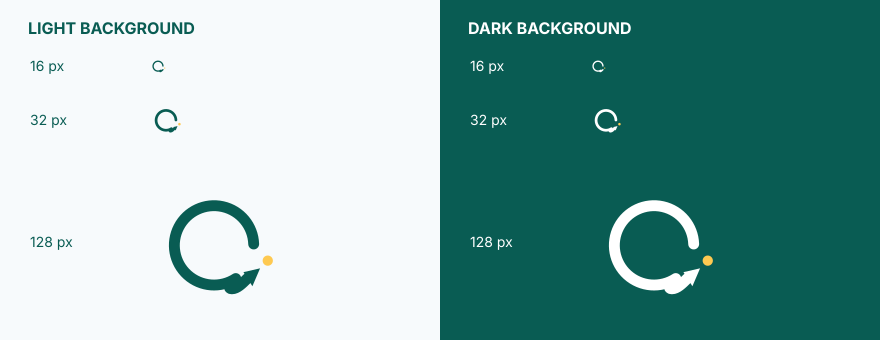

# NextCycle brand

Credible, calm, precise public-data communication. No hype, stock photographs, water-droplet imagery, gradients, meshes, or glowing effects.

## Logo

The original mark is a nearly circular, roughly 300° arrow. A short part of its stroke becomes a gentle stream; the amber point sits just ahead of the arrowhead to signal what is next. The mark has no lettering, gradients, droplets, or splashes. The arrow is Deep Teal `#095C53` and the point is Amber `#FEC951`; the dark-background version uses a white stroke and the same amber point.

Use `public/brand/nextcycle-mark.svg` on light backgrounds and `nextcycle-mark-white.svg` on dark backgrounds. Use the corresponding `nextcycle-logo*.svg` lockup when the wordmark is needed. The logo wordmark uses Inter 700. The app navigation, browser icons, and generated share images use the new mark.

## Typography

Self-hosted Inter, Arial fallback. Body weight 400; headings 600–700. Sentence case. Use a monospace face for identifiers and tabular numbers.

## Palette

| Role | Color |
|---|---|
| Primary | `#095C53` |
| Primary hover | `#06433D` |
| Supporting teal | `#3D8A80` |
| Light teal | `#A9D3CD` |
| Link teal | `#167680` |
| Cyan data accent | `#2BB6C1` |
| Amber | `#FEC951` |
| Amber text | `#8A6100` |
| Urgent icon only | `#FF5500` |
| Body | `#666666` |
| Technical text | `#123047` |
| Metadata/unknown | `#647581` |
| Background | `#F7FAFC` |
| Cards | `#FFFFFF` |
| Section fill | `#E6F2F0` |
| Border/grid | `#D9DEDD` |
| Water accent | `#1479B8` |
| Water tint | `#E7F5FA` |
| Deep water | `#0E4C7A` |

Never use cyan or amber text on white. No red/green good-bad encoding. Orange is limited to one warning icon per page.

## Status semantics

- **Delisting candidate:** check-circle, teal label, light-teal fill.
- **Still exceeding:** alert-triangle, dark amber label, amber fill.
- **Under-sampled:** help-circle, slate label, dashed outline; dashed map geometry.
- **Official status:** separate outline badge, never replaced by a screening flag.

Every status needs text and an icon, not just color. Official assessment and independent screening must stay distinct on every surface, including shared figures.

## Voice

Plain, short, precise sentences. Explain acronyms on first use. Never imply an independent screening result is a regulatory decision. Always label illustrative results as demonstration data.
